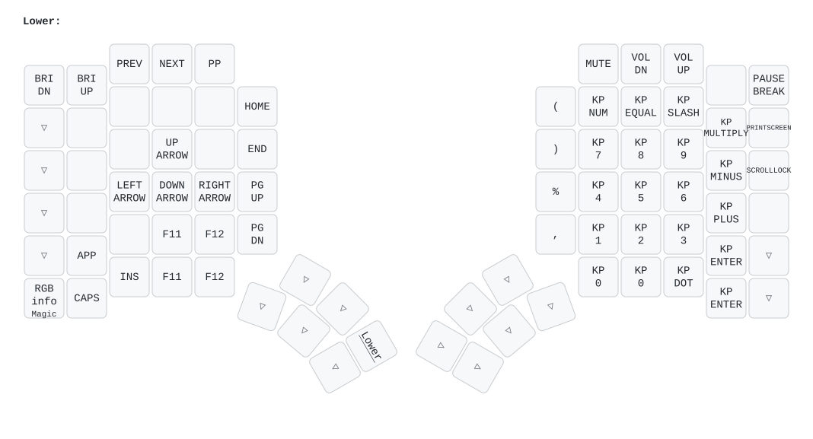
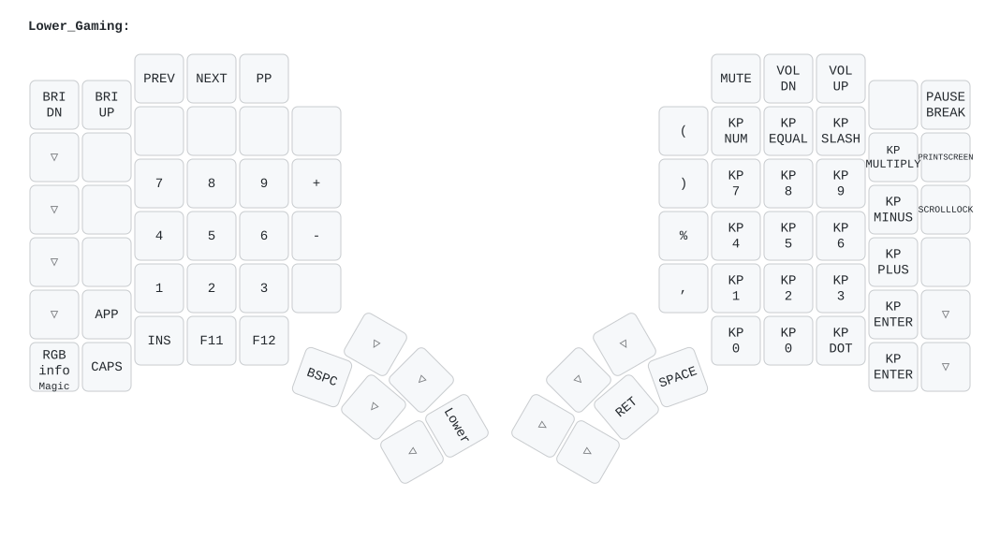

# Constantine’s Glove80 Firmware

Custom ZMK firmware for Constantine’s Glove80. It preserves the five-layer ergonomic keymap while adding layer-aware per-key indicators, seven animated RGB moods, Gaming-specific guidance, and persistent lighting controls.

## Highlights

- Per-key RGB indicators for Lower, Gaming, and Lower Gaming.
- Seven Base-layer moods inspired by the WLED presets used at home.
- The selected mood and idle auto-off preference persist across power cycles.
- Gaming indicators stay identical regardless of the selected Base mood.
- A combined UF2 is built automatically by GitHub Actions for both halves.
- Firmware dependencies are pinned for reproducible builds.

## RGB controls

| Shortcut | Action |
|---|---|
| `Magic+G` | Cycle Aurora → Fire → Pacifica → Forest → Party → Colorloop/Stripe Flow → Ukrainian Flag |
| `Magic+T` | Toggle RGB power |
| `Magic+I` | Toggle the 30-second idle auto-off preference |

Aurora and RGB power are the reset-time defaults. There is deliberately no Off entry in the mood cycle; use `Magic+T` to turn lighting off.

### Base moods

- **Aurora:** slow cyan/green/purple waves.
- **Fire:** smooth WLED-inspired 2D heat field with independent flame columns, hot lower rows, and cooler rising tongues.
- **Pacifica:** slow layered blue/cyan waves.
- **Forest:** slow green movement at two-thirds of the original animation speed.
- **Party:** continuous saturated multicolor motion without flashing sparkles.
- **Colorloop / Stripe Flow:** flowing rainbow stripes at one-quarter of the original speed.
- **Ukrainian Flag:** blue upper half and yellow lower half with a slow wave that moves across the board in two crests. Blue runs brighter (50–90%) than yellow (35–75%) so both read evenly on the LEDs. Because the crests are spread out, the total LED load stays flat instead of the whole board pulsing at once, keeping its power draw in line with the other moods.

## Layers

▽ marks a transparent key, which falls through to the layer below. The images are drawn with [keymap-drawer](https://github.com/caksoylar/keymap-drawer) by the **Draw keymap** workflow, which redraws them whenever `config/glove80.keymap` changes.

### Base

The normal typing layer. It displays the selected animated mood.

### Lower

Functional color guidance:

- Media and utility controls: orange
- Navigation arrows: blue
- Numpad digits, including both zero keys: cyan
- Num Lock: purple
- Divide, Multiply, Minus, and Plus: yellow
- Decimal: pink
- Keypad Enter: green
- Keypad Equals: white
- Print Screen: red
- Layer key: white

### Magic

Retains the existing system controls and has no custom per-layer RGB map. `Magic+I` is the only added binding, used for the persistent idle auto-off toggle.

### Gaming

The physical `E/S/D/F` keys emit `W/A/S/D` and light cyan. Escape is red, Space is green, and Control is purple.

The shifted left edge restores occasionally needed keys:

- Grave position → `5`
- Tab position → `T`
- Caps Lock position → `G`
- Left Shift position → `B`

### Lower Gaming

The separate left-side number cluster is orange. The right-side numpad uses the same semantic colors as Lower. Gaming’s normal functional indicators are restored when returning to Gaming.

## Build and flash

Tested firmware is published on the [**Releases**](https://github.com/constantinchik/glove80-zmk-config/releases) page. Download `glove80.uf2` from the latest release.

To try an unreleased change instead: every push runs [`.github/workflows/build.yml`](.github/workflows/build.yml), and a successful run publishes a `glove80.uf2` artifact. Open the **Actions** tab, select the latest successful **Build** run for the branch, and download the artifact.

Then:

1. Keep the previous UF2 so you can roll back.
2. Flash the same combined UF2 to **both** Glove80 halves using the official [MoErgo firmware-loading instructions](https://docs.moergo.com/glove80-user-guide/customizing-key-layout/).
3. Test Base moods, all layers, idle/wake, power cycling, and both halves. With each mood on, type on both halves to confirm they stay responsive.

A configuration reset is normally unnecessary for an ordinary upgrade. Use it only when testing reset-time defaults or recovering stale settings; it clears stored preferences and may require Bluetooth re-pairing.

## Implementation

This repository intentionally owns only the configuration and a small source patch:

- [`config/glove80.keymap`](config/glove80.keymap): five layers, Gaming remaps, Magic controls, and 80-entry RGB maps.
- [`config/glove80.conf`](config/glove80.conf): RGB enablement, reset defaults, and 30-second idle timeout.
- [`patches/default-layer-effect.patch`](patches/default-layer-effect.patch): mood engine, layer-map composition, effect cycling, and persistent idle auto-off toggle.
- [`.github/workflows/build.yml`](.github/workflows/build.yml): checks out and patches the pinned firmware source, then builds the combined UF2.
- [`.github/workflows/draw.yml`](.github/workflows/draw.yml) and [`keymap_drawer.config.yaml`](keymap_drawer.config.yaml): redraw the layer images in [`docs/layers`](docs/layers) whenever the keymap changes, and commit them back to the branch.

The build uses [`darknao/zmk`](https://github.com/darknao/zmk) pinned to commit `8aeaaa66fbb4b94948c8763e06f1920ab0b69480`. The workflow applies the repository-owned patch with `git apply`, so an incompatible upstream change fails loudly rather than silently changing behavior.

### Important invariants

When changing this firmware:

- Preserve all five layers unless a remap is explicitly requested.
- Keep every RGB layer map at exactly 80 bindings.
- Author RGB maps in keymap-position order; the firmware resolves physical LEDs through the board pixel lookup.
- Keep Base moods independent from static layer maps.
- Keep Gaming styling identical across every mood.
- Append new effects instead of renumbering existing saved moods.
- Keep RGB power and idle auto-off as separate controls.
- Pin firmware sources to exact commits.
- Keep each mood's total LED load in line with the others: offset waves per key or column so the whole board never brightens at once.
- Build in GitHub Actions and flash/test both halves before merging.

## Rollback

- Last stock-keymap rollback point: commit `07e08a5`.
- To roll back, flash the UF2 from an earlier [release](https://github.com/constantinchik/glove80-zmk-config/releases), or build that commit and flash its combined UF2, to both halves.
- Keep a known-good UF2 available before testing firmware changes.

## References

- [Glove80 documentation](https://docs.moergo.com/glove80-user-guide/)
- [MoErgo support](https://moergo.com/glove80-support)
- [ZMK documentation](https://zmk.dev/docs)
